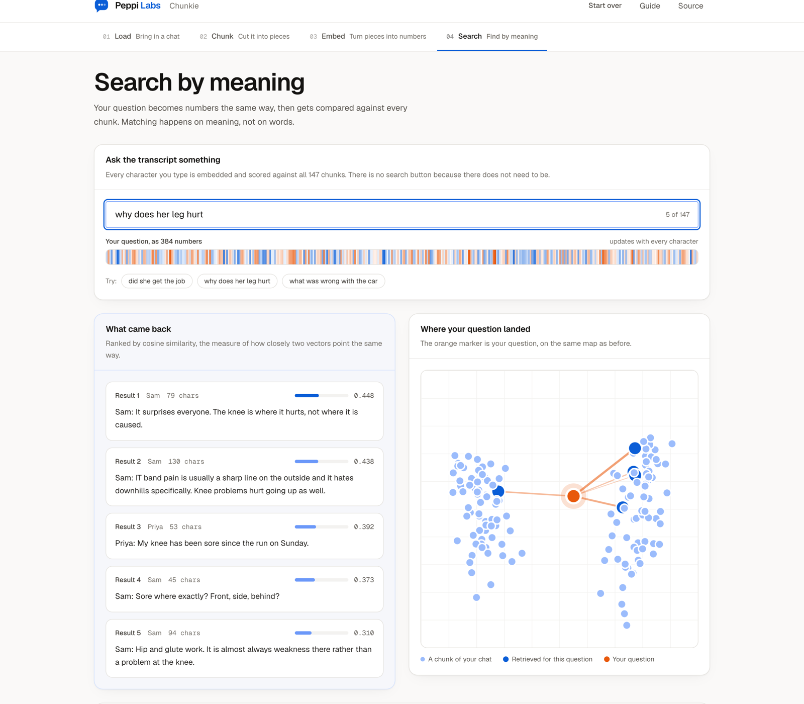
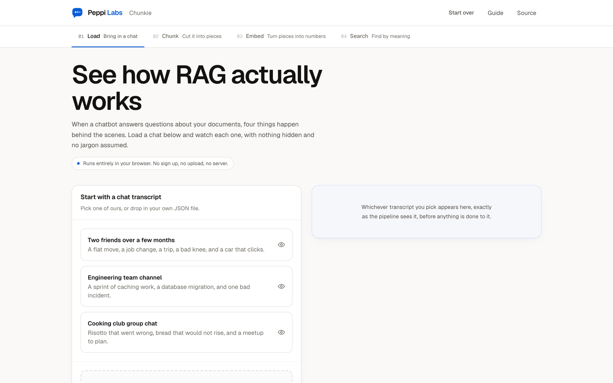

<div align="center">


# Chunkie

**See how retrieval augmented generation actually works.**

Clone it, run it, and watch a chat transcript get chunked, turned into vectors, and searched by
meaning. Every step is visible, nothing is hidden, and no jargon is assumed.

[](LICENSE)
[](https://react.dev)
[](#how-it-works)

A [Peppi Labs](https://github.com/PeppiLabs) open source project.



</div>

---

## The guide

There is a full written explanation of every idea in here, in
**[`public/concepts.html`](public/concepts.html)**: chunking, tokens, embeddings, vectors, cosine
similarity, the 2D projection, retrieval, where RAG fails, and how this project is built.

It is a self contained HTML page, so open it whichever way suits:

```bash
open public/concepts.html          # macOS
xdg-open public/concepts.html      # Linux
start public\concepts.html         # Windows
```

Or run the app and click **Guide** in the header, which serves it at
<http://localhost:5173/concepts.html>.

GitHub shows HTML files as source rather than rendering them, so read it in a browser rather than
in the file view here.

## What this is

Most explanations of RAG are diagrams. This one is the real thing, running in front of you.

You load a chat transcript, and the app walks through the four stages every RAG system performs:

| Stage | What happens | What you can see |
| --- | --- | --- |
| **1. Load** | A JSON transcript is parsed into messages | The raw chat, exactly as the system sees it |
| **2. Chunk** | The chat is cut into retrievable pieces | Chunk boundaries, sizes, and the overlap between them |
| **3. Embed** | Each chunk becomes 384 numbers | The actual vector values, and a 2D map of the vector space |
| **4. Search** | Every keystroke is compared to every chunk | Your question's vector changing as you type, cosine scores, ranked results, and the context an LLM would receive |

The point most people miss is stage 4. Ask the friends transcript "why does her leg hurt" and the
passage it returns is "the knee is where it hurts, not where it is caused", followed by a
discussion of IT band pain that never uses the word leg. A keyword search for "leg" finds nothing
useful. That gap is the entire reason RAG systems bother with embeddings, and you can watch it
happen.

Search runs on every character you type, with no button to press, because embedding one short
question takes about a millisecond. Watching the ranking rearrange as you type is the clearest
demonstration of what the model is actually doing.

## Try it

Clone the repository and run it (see [Running it](#running-it) below). Three transcripts are
bundled, so there is nothing to find first, and you can drop in your own JSON file at any point.



## How it works

**There is no backend.** The embedding model runs inside your browser tab via
[transformers.js](https://github.com/huggingface/transformers.js), and the vector search is plain
cosine similarity over an in-memory array.

That is a deliberate design choice, not a shortcut:

- **Your data never leaves your machine.** Files are read by the browser and stay in the tab.
- **No account, no database, no server process.** Just a dev server serving static files.
- **No API keys and no paid services.** Nothing to sign up for before it works.
- **The numbers on screen are real.** They are the model's actual output, not a simulation.

```
Your browser
  transcript.json
        |
        v
  parse  ->  chunk  ->  embed (WASM, in a Web Worker)  ->  vectors in memory
                                                                |
  your question  ->  embed  ->  cosine similarity vs every chunk  ->  ranked results
```

| Piece | Choice | Why |
| --- | --- | --- |
| Embedding model | `Xenova/all-MiniLM-L6-v2`, 384 dimensions, int8 quantised | Around 23 MB, small enough to download once and good enough to demonstrate real semantic behaviour |
| Runtime | ONNX Runtime Web (WASM) | Runs the model in a Web Worker so the interface never freezes |
| Vector store | A JavaScript array | With a few hundred chunks, an exhaustive scan is instant. A real system would use a vector database, and the app says so |
| 2D projection | Principal component analysis, implemented in `src/lib/vector.ts` | The two axes are the directions the chunks differ along most, so on-screen distance reflects real distance |

## Running it

Requires Node.js 22.12 or newer. Check with `node -v`.

```bash
git clone https://github.com/PeppiLabs/chunkie.git
cd chunkie
npm install
npm run password -- --write
npm run dev
```

The `password` step prints a new site password once. Keep it, because the visualizer asks for it
(see [The site password](#the-site-password) below). Then open the URL the terminal prints, usually
<http://localhost:5173>. The landing page opens without the password. "Launch visualizer" opens
<http://localhost:5173/app/>, which asks for it.

The first time you reach the Embed step, the browser downloads the embedding model, roughly 23 MB.
That happens once and your browser caches it, so every later run starts immediately. It needs an
internet connection for that first download only; everything after it is local.

| Command | Does |
| --- | --- |
| `npm run dev` | Start the dev server with hot reload |
| `npm run build` | Type check and build to `dist/` |
| `npm run preview` | Serve the built site locally |
| `npm run lint` | Run ESLint |
| `npm run typecheck` | Type check without emitting |
| `npm run password -- --write` | Set a new site password |

### The site password

The dev server and the preview server both ask for a password before they serve anything, apart
from `/healthz`. That is how staging runs. To show the landing page at `/` without the password,
set `SITE_PUBLIC_LANDING=true` in `.env.local`. Then the landing page and exactly the scripts,
styles and fonts it needs are public, and everything else (the visualizer, its workers, the
samples, the concepts guide, and the hot reload connection) still needs the password. Any value
other than exactly `true` keeps the landing page private. Whatever the landing page imports
becomes public when it is on, so keep visualizer code out of `src/landing.tsx` and the
components it uses.

With `SITE_PUBLIC_LANDING=true`, the built site's list of public files comes from the manifest that
`npm run build` writes. If that manifest is missing, for example when `dist/` predates this layout,
nothing is public, and the preview server says so in the terminal. Run `npm run build` again. The
preview server reads the manifest when it starts, so restart it after every `npm run build`.

`npm run password -- --write` makes a new random 13 character password, prints it once, and saves
only a hash of it to `.env.local`. A hash is a one way fingerprint: the server can check a typed
password against it, but the password cannot be worked back out of it. The password itself is
never written to disk, and `.env.local` is git ignored, so neither ends up in the repository. Copy
the password when it is printed, because there is no way to show it again.

- **To change the password,** run the command again. Everyone who was signed in is signed out.
- **To sign out,** visit `/logout`.
- **A sign-in lasts 3 hours,** then the password is asked for again. The server checks the time
  itself, so a copy of the sign-in cookie stops working at the same moment.
- **Tests and `npm run build` need no password,** since neither of them serves anything.
- **`/healthz` answers without the password.** It says "ok" and nothing else, so an uptime ping or
  a health check gets a success rather than the login page's 401. It shows nothing of the app.

The password protects the dev and preview servers only. If you ever serve the built output some
other way, it is not protected, so use whatever access control that host provides.

### About the cross origin headers

`vite.config.ts` sets `Cross-Origin-Opener-Policy` and `Cross-Origin-Embedder-Policy` for both the
dev server and the preview server. They make the page cross origin isolated, which is what lets the
WASM runtime use its faster multi threaded backend.

If you ever serve the built output some other way, without those two headers the model still runs,
just on a slower single threaded path.

## Bringing your own transcript

Any JSON file up to 5 MB. The parser accepts an array of messages, or an object containing one
(it looks for `messages`, `conversation`, `chat`, `history`, `data`, or `items`, and otherwise
falls back to the longest array it finds).

Each message needs a text field. These names are recognised:

- **Text** (required): `text`, `message`, `content`, `body`, `answer`, `value`
- **Speaker**: `speaker`, `sender`, `author`, `user`, `from`, `name`, `role`
- **Timestamp**: `timestamp`, `time`, `date`, `created_at`, `sent_at`

```json
[
  { "speaker": "Priya", "timestamp": "2026-03-02T09:14:00Z", "text": "My package still has not turned up." },
  { "speaker": "Support", "timestamp": "2026-03-02T09:15:10Z", "text": "Sorry about that, can you give me the order number?" }
]
```

The three bundled samples live in [`public/samples/`](public/samples) and are entirely synthetic.
They contain no real people and no personal data.

| Sample | Size | What is in it |
| --- | --- | --- |
| Two friends over a few months | 147 messages, 2 people | A flat move, a job change, a trip, a running injury, a car fault |
| Engineering team channel | 115 messages, 4 people | Caching work, a database migration, and one bad incident |
| Cooking club group chat | 115 messages, 4 people | Risotto, bread, seasoning, and planning a meetup |

## Project layout

```
index.html          The public landing page
app/index.html      The visualizer, behind the password
src/
  landing.tsx       Starts the landing page. Everything it imports is public
  main.tsx          Starts the visualizer
  lib/
    siteUrls.ts     Where the two pages live, and old links sent on
    parse.ts        Turns an uploaded file into messages
    chunk.ts        The three chunking strategies
    vector.ts       Cosine similarity and the PCA projection
    embedder.ts     Main thread client for the worker
  worker/
    embedder.worker.ts   Loads and runs the model off the main thread
  hooks/
    useRagPipeline.ts    Owns the pipeline state end to end
  components/
    steps/          One component per stage
    viz/            Vector strip, 2D map, score bars, chunk cards
    common/         Buttons, panels, the explainer callouts
    layout/         Header, footer, step navigation
public/samples/     The three bundled transcripts
public/concepts.html  The written guide to every concept
docs/screenshots/   The images in this readme
server/passwordGate.ts         The password check in front of the dev and preview servers
server/publicPaths.ts          Which files the landing page needs, served without the password
scripts/generate-password.mjs  Makes a new site password and saves only its hash
```

## A note on `npm audit`

`npm audit` reports advisories in `sharp` and `onnxruntime-node`. Both arrive as dependencies of
`@huggingface/transformers`, and both are **Node.js only**: `sharp` handles server side image
processing and `onnxruntime-node` is the native inference backend. This app is a browser build that
uses `onnxruntime-web`, so neither package is ever bundled or shipped.

You can verify that yourself:

```bash
npm run build
grep -r "onnxruntime-node" dist/    # no matches
grep -r "sharp" dist/               # no matches
```

They are install time dependencies of the toolchain, not part of what visitors download.

## Learning more

The [concepts guide](public/concepts.html) covers the ideas in depth. If you would rather read
code, every concept has exactly one file that implements it:

| Idea | File |
| --- | --- |
| Chunking, and the three strategies | [`src/lib/chunk.ts`](src/lib/chunk.ts) |
| Cosine similarity and the 2D projection | [`src/lib/vector.ts`](src/lib/vector.ts) |
| Running the model off the main thread | [`src/worker/embedder.worker.ts`](src/worker/embedder.worker.ts) |
| The pipeline state end to end | [`src/hooks/useRagPipeline.ts`](src/hooks/useRagPipeline.ts) |

## Contributing

Contributions are welcome. See [CONTRIBUTING.md](CONTRIBUTING.md).

The most useful contributions are the ones that make a concept clearer to somebody encountering it
for the first time. If a sentence in the app confused you, that is a bug worth reporting.

## License

[MIT](LICENSE). Copyright 2026 Peppi Labs.
